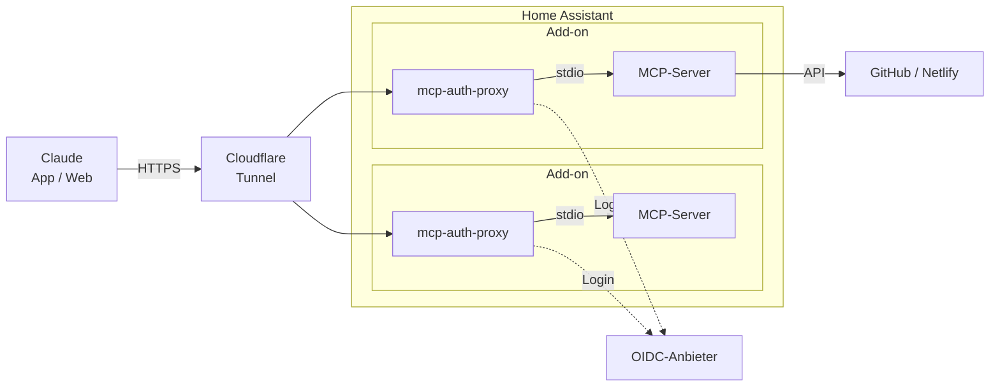

# didi's Apps für Home Assistant

## Ziel

Claude soll auch unterwegs, aus der Smartphone-App heraus, mit eigenen Werkzeugen arbeiten:
Grafiken und PDFs bearbeiten, Code und Inhalte auf GitHub ändern, Websites über Netlify
veröffentlichen. Viele dieser Werkzeuge gibt es als MCP-Server, aber nur lokal über stdio.
Die Claude-App kann solche Server nicht starten. Sie braucht einen Remote-Server mit HTTPS
und OAuth-Login.

Dieses Repository macht aus stdio-MCP-Servern Remote-Connectoren, die dauerhaft auf einem
Home-Assistant-Gerät laufen (z. B. Raspberry Pi), sicher hinter einem Login stehen und sich
wie jedes andere Add-on installieren, konfigurieren, sichern und aktualisieren lassen.

Dazu kommt eine eigene Chat-Oberfläche auf demselben Gerät: **Open WebUI** mit europäischen
oder eigenen Modellen (z. B. Scaleway), Web-Suche und **Open Terminal**. Sie nutzt dieselben
MCP-Apps als Werkzeuge, über ihre öffentliche URL mit Login oder im internen Netz von Home
Assistant ohne Login (Option `internal_access`, bei ArtCraft `internal_apps`).

## Funktionsumfang

| Add-on | MCP-Server | Wofür |
|---|---|---|
| [ArtCraft MCP](artcraft_mcp/DOCS.md) | VectorCraft, PhotoCraft, PdfCraft, CADCraft, WordCraft, DeckCraft, GridCraft, FigCraft, Craft Anything ([storytold](https://github.com/storytold)) | Grafik, Bilder, PDFs, CAD, Office-Dateien, mit mitgelieferten Schriften, im gemeinsamen Arbeitsordner unter `/share`. Hintergrund: [docs/ARTCRAFT.md](docs/ARTCRAFT.md) |
| [Foto MCP](foto_mcp/DOCS.md) | eigener Server (Python, [OpenCV](https://opencv.org), [MediaPipe](https://ai.google.dev/edge/mediapipe)) | Fotos sichten, aussortieren, begradigen (Horizont zuerst), Bildtyp erkennen und danach zuschneiden, Regler wie in Snapseed, Rezepte, Protokoll, dezent retuschieren, im selben Arbeitsordner wie ArtCraft |
| [GitHub MCP](github_mcp/DOCS.md) | [github-mcp-server](https://github.com/github/github-mcp-server) (offiziell) | Repos lesen und ändern, Branches, Pull Requests, Issues, Actions, mit eigenem Token statt der GitHub-App |
| [mailbox.org MCP](mailbox_org_mcp/DOCS.md) | imap-mcp, smtp-mcp, caldav-mcp, carddav-mcp ([ni-c](https://github.com/ni-c)), eigener WebDAV-Server, gebündelt über [mcp-hub](https://github.com/ni-c/mcp-hub) | Mail lesen und (mit Bestätigung) senden, Kalender, Adressbuch, Drive. Anders als die übrigen: ein Hostname mit Pfad je Dienst, Login über das Hub-Passwort oder Passkey (Pocket ID), intern über Ports 9081–9085 |
| [Netlify MCP](netlify_mcp/DOCS.md) | [@netlify/mcp](https://www.npmjs.com/package/@netlify/mcp) (offiziell) | Sites, Deploys und Deploy Previews, Build-Logs, Umgebungsvariablen |

Jedes MCP-Add-on:

- **Login:** [mcp-auth-proxy](https://github.com/sigbit/mcp-auth-proxy) ist gegenüber Claude der
  OAuth-Server (Dynamic Client Registration) und lässt nur Nutzer durch, die sich bei einem
  OIDC-Anbieter wie Pocket ID anmelden.
- **Erreichbarkeit:** ein HTTPS-Hostname je MCP-Server, z. B. über das Cloudflared-Add-on. Keine
  offenen Ports nötig.
- **Intern ohne Login (optional):** Mit `internal_access` zusätzlich unter
  `http://<repo-hash>-<slug>:9080/mcp` im internen Netz erreichbar, z. B. für Open WebUI auf
  demselben Gerät. Eine kleine Brücke (`common/mcp_bridge.py`) ersetzt dort den Login-Proxy.
- **Konfiguration** im Home-Assistant-UI, Secrets als Passwortfelder, Proxy-Daten im Backup der App.
- **Feste Versionen** mit geprüften Prüfsummen. Ein täglicher Workflow prüft neue Releases, baut
  für aarch64 und amd64, startet jeden Server mit genau den Optionen des Add-ons (Selbsttest) und
  erhöht erst dann die Version. Home Assistant zeigt das Update an, installiert wird auf Klick.
- **Robust:** Stürzt ein Server ab, startet nur er neu. Das OIDC-Secret erreicht die MCP-Server nicht.

GitHub MCP und Netlify MCP zusammen ergeben einen Ablauf für die Pflege statischer Websites
durch Claude: Änderung als Pull Request, Prüfung in der Deploy Preview, Freigabe durch einen
Menschen. Beschrieben in [docs/WEBSITE-PFLEGE.md](docs/WEBSITE-PFLEGE.md).

Außerdem, ohne MCP-Server:

| App | Was | Wofür |
|---|---|---|
| [Open WebUI](open_webui/DOCS.md) | [Open WebUI](https://github.com/open-webui/open-webui) (offizielles Image) | Chat-Oberfläche für externe und eigene Modelle, mit Login über OIDC und Übernahme einer bestehenden Installation. Nutzt die MCP-Apps oben als Tool-Server. Mit eingebauter Web-Suche (SearXNG). Eigenes Startskript. Neue Versionen werden täglich geprüft, getestet und als Update angeboten |
| [Open Terminal](open_terminal/DOCS.md) | [Open Terminal](https://github.com/open-webui/open-terminal) (offizielles Image) | Shell, Dateien und Werkzeuge für Modelle in Open WebUI, im eigenen Container. Open WebUI trägt die Verbindung selbst ein. Updates wie bei Open WebUI |

## Icons

Alle Apps tragen denselben runden Badge in Dunkelblau und Bernstein mit einem eigenen,
schlichten Symbol. Erzeugt von `icons/make_icons.py` (`icon.png`, `logo.png` je App); neue
Apps dort eintragen.

## Arbeitsordner

ArtCraft, Foto MCP und Open Terminal (`~/work`) teilen sich `/share/artcraft/work` mit
`inbox/` für Eingänge und `out/` für Ergebnisse. Dateien kommen über den Chat (Datei-Panel
des Terminals) oder über mailbox.org Drive hinein, nicht über eine Synchronisation auf alle
Geräte.

Aufgeräumt wird von Home Assistant: [`homeassistant/pyscript/work_cleanup.py`](homeassistant/pyscript/work_cleanup.py)
nach `/config/pyscript/` kopieren ([Pyscript](https://github.com/custom-components/pyscript)
muss installiert sein). Dateien in `inbox/` und `out/` werden 14 Tage nach dem ersten
Auftauchen gelöscht; 2 Tage vorher kommt eine Benachrichtigung mit dem Knopf
„Alle behalten“ (verschiebt nach `behalten/`). Ziel der Benachrichtigung und Fristen stehen
oben im Skript.

## Installation

Oder von Hand: Einstellungen → Apps (Add-ons) → App Store → ⋮ → Repositories →
`https://github.com/kleinhansda/ha-addons`. Danach die gewünschten Add-ons einzeln
installieren. Einrichtung je Add-on in dessen `DOCS.md`, auch in Home Assistant sichtbar.

> **Bestehende Installationen:** Das Repository hieß früher `ha-mcp-addons`. GitHub leitet die
> alte Adresse weiter, Home Assistant aktualisiert weiter wie gewohnt. Die Adresse im App Store
> **nicht** auf die neue ändern: Home Assistant leitet die App-Kennungen aus der Adresse ab, mit
> neuer Adresse wären alle Apps neue Apps mit leeren Daten.

## Architektur

Warum Add-ons und nicht HACS, Portainer-Stacks, MCPHub oder die gehosteten Server der Anbieter:
[docs/ARCHITEKTUR.md](docs/ARCHITEKTUR.md).

## Aufbau des Repos

| Pfad | Inhalt |
|---|---|
| `<add-on>/config.yaml` | Name, Version, Optionen |
| `<add-on>/Dockerfile` | Image mit festen Versionen und Prüfsummen |
| `<add-on>/DOCS.md`, `CHANGELOG.md` | Einrichtung und Versionen, in Home Assistant sichtbar |
| `<add-on>/rootfs/usr/local/lib/mcp/services.sh` | Welche Server das Add-on startet, mit welchen Optionen und Ports |
| `common/run.sh`, `common/mcp-selftest`, `common/mcp_bridge.py` | Gemeinsames Startskript, Selbsttest und Brücke für den internen Zugriff. Kopien liegen in jedem Add-on, `.github/scripts/sync_common.py` gleicht sie ab. ArtCraft hat ein eigenes Startskript (`apps.sh`, `artcraft-selftest`) und nutzt nur die Brücke |
| `.github/workflows/build.yml` | Baut und testet jedes Add-on auf beiden Architekturen |
| `.github/workflows/update.yml` | Prüft täglich neue Releases (MCP-Server, mcp-auth-proxy, Open WebUI, Open Terminal) und trägt sie nach bestandenem Test auf beiden Architekturen ein |
| `homeassistant/pyscript/` | Skripte für Home Assistant selbst (Aufräumen des Arbeitsordners) |
| `docs/` | Hintergrund und Entscheidungen |

Ein weiterer stdio-MCP-Server wird zum Add-on, indem man einen Add-on-Ordner mit `config.yaml`,
`Dockerfile` und `services.sh` anlegt, `sync_common.py` ausführt und die Quelle in
`update_versions.py` einträgt.

## Hinweis

Inoffizielles Projekt, nicht mit Anthropic, GitHub, Google, Netlify, storytold oder sigbit verbunden.
Die MCP-Server stehen unter ihren eigenen Lizenzen, siehe deren Repositories.
