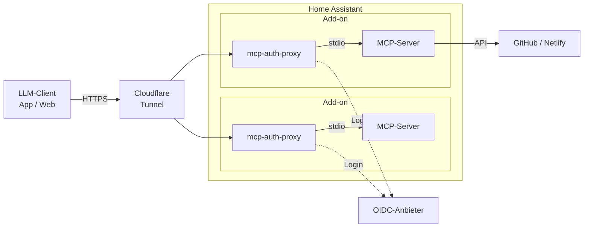

# didi's Apps für Home Assistant

## Ziel

Ein LLM soll auch unterwegs, aus einer Chat-App auf dem Smartphone heraus, mit eigenen
Werkzeugen arbeiten: Grafiken und PDFs bearbeiten, Code und Inhalte auf GitHub ändern, Websites
über Netlify veröffentlichen. Viele dieser Werkzeuge gibt es als MCP-Server, aber nur lokal über
stdio. Chat-Apps können solche Server nicht starten. Sie brauchen einen Remote-Server mit HTTPS
und OAuth-Login.

Dieses Repository macht aus stdio-MCP-Servern Remote-Connectoren, die dauerhaft auf einem
Home-Assistant-Gerät laufen, sicher hinter einem Login stehen und sich
wie jedes andere Add-on installieren, konfigurieren, sichern und aktualisieren lassen.

Dazu kommt eine eigene Chat-Oberfläche auf demselben Gerät: **Open WebUI** mit europäischen
oder eigenen Modellen (z. B. Scaleway), Web-Suche und **Open Terminal**. Sie nutzt dieselben
MCP-Apps als Werkzeuge, über ihre öffentliche URL mit Login oder im internen Netz von Home
Assistant ohne Login (Option `internal_access`, bei ArtCraft `internal_apps`).

## Funktionsumfang

| Add-on | MCP-Server | Wofür |
|---|---|---|
| [ArtCraft MCP](artcraft_mcp/DOCS.md) | VectorCraft, PhotoCraft, PdfCraft, CADCraft, WordCraft, DeckCraft, GridCraft, FigCraft, Craft Anything ([storytold](https://github.com/storytold)) | Grafik, Bilder, PDFs, CAD, Office-Dateien, mit mitgelieferten Schriften, im gemeinsamen Arbeitsordner unter `/share`. Hintergrund: [docs/ARTCRAFT.md](docs/ARTCRAFT.md) |
| [Files MCP](files_mcp/DOCS.md) | eigener Server (Python) | Dateien unter `/share` für LLM-Clients ohne Terminal: auflisten, lesen, gezielt bearbeiten, suchen, verschieben, Papierkorb, Metadaten (EXIF, PDF, Office, CSV), Vorschau von Bildern und PDF-Seiten. Mit Wurzelordner, Nur-lesen-Modus und geschützten Ordnern |
| [Foto MCP](foto_mcp/DOCS.md) | eigener Server (Python, [OpenCV](https://opencv.org), [MediaPipe](https://ai.google.dev/edge/mediapipe)) | Fotos sichten, aussortieren, begradigen (Horizont zuerst), Bildtyp erkennen und danach zuschneiden, Regler wie in Snapseed, Rezepte, Protokoll, dezent retuschieren, im selben Arbeitsordner wie ArtCraft |
| [GitHub MCP](github_mcp/DOCS.md) | [github-mcp-server](https://github.com/github/github-mcp-server) (offiziell) | Repos lesen und ändern, Branches, Pull Requests, Issues, Actions, mit eigenem Token statt der GitHub-App |
| [mailbox.org MCP](mailbox_org_mcp/DOCS.md) | imap-mcp, smtp-mcp, caldav-mcp, carddav-mcp ([ni-c](https://github.com/ni-c)), eigener WebDAV-Server, gebündelt über [mcp-hub](https://github.com/ni-c/mcp-hub) | Mail lesen und (mit Bestätigung) senden, Kalender, Adressbuch, Drive. Anders als die übrigen: ein Hostname mit Pfad je Dienst, Login über das Hub-Passwort oder Passkey (Pocket ID), intern über Ports 9081–9085 |
| [Netlify MCP](netlify_mcp/DOCS.md) | [@netlify/mcp](https://www.npmjs.com/package/@netlify/mcp) (offiziell) | Sites, Deploys und Deploy Previews, Build-Logs, Umgebungsvariablen |
| [Google Workspace MCP](google_workspace_mcp/DOCS.md) | [workspace-mcp](https://github.com/taylorwilsdon/google_workspace_mcp) (Python) | Google Workspace für ein Konto: Gmail lesen (optional Entwürfe), Kalender und Drive lesen oder schreiben, Upload aus `/share`; Anmeldung über einen Link im Log |
| [Mailchimp MCP](mailchimp_mcp/DOCS.md) | [mailchimp-mcp](https://github.com/damientilman/mailchimp-mcp-server) (Python) | Mailchimp: Zielgruppen, Kontakte, Kampagnen und Berichte lesen; optional Kampagnen-Entwürfe und Testmails, Versand nur mit Umfang „alle“ |
| [Paperless MCP](paperless_mcp/DOCS.md) | eigener Server (Python) | Paperless-ngx als Wissensquelle: Volltextsuche mit Filtern nach Tag, Korrespondent, Typ und Datum, OCR-Text lesen, Vorschau der ersten Seite, ähnliche Dokumente; optional Tags, Titel und Notizen pflegen oder Dateien hochladen |

Jedes MCP-Add-on:

- **Login:** [mcp-auth-proxy](https://github.com/sigbit/mcp-auth-proxy) ist gegenüber dem LLM-Client
  der OAuth-Server (Dynamic Client Registration) und lässt nur Nutzer durch, die sich bei einem
  OIDC-Anbieter wie Pocket ID anmelden.
- **Erreichbarkeit:** ein HTTPS-Hostname je MCP-Server, z. B. über das Cloudflared-Add-on. Keine
  offenen Ports nötig.
- **Intern ohne Login (optional):** Mit `internal_access` zusätzlich unter
  `http://<repo-hash>-<slug>:9080/mcp` im internen Netz erreichbar, z. B. für Open WebUI auf
  demselben Gerät. Eine kleine Brücke (`common/mcp_bridge.py`) ersetzt dort den Login-Proxy.
  Mit `internal_token` verlangt die Brücke ein Bearer-Token (empfohlen): Ohne Token kann jede
  App und jedes Werkzeug mit Zugang zum internen Netz die Dienste nutzen, auch die
  Proxy-Funktion von ha-mcp. In Open WebUI: Authentifizierung „Bearer“, Token eintragen.
- **Konfiguration** im Home-Assistant-UI, Secrets als Passwortfelder, Proxy-Daten im Backup der App.
- **Feste Versionen** mit geprüften Prüfsummen. Ein täglicher Workflow prüft neue Releases, baut
  für aarch64 und amd64, startet jeden Server mit genau den Optionen des Add-ons (Selbsttest) und
  erhöht erst dann die Version. Home Assistant zeigt das Update an, installiert wird auf Klick.
- **Robust:** Stürzt ein Server ab, startet nur er neu. Das OIDC-Secret erreicht die MCP-Server nicht.

GitHub MCP und Netlify MCP zusammen ergeben einen Ablauf für die Pflege statischer Websites
durch ein LLM: Änderung als Pull Request, Prüfung in der Deploy Preview, Freigabe durch einen
Menschen. Beschrieben in [docs/WEBSITE-PFLEGE.md](docs/WEBSITE-PFLEGE.md).

Außerdem, ohne MCP-Server:

| App | Was | Wofür |
|---|---|---|
| [Open WebUI](open_webui/DOCS.md) | [Open WebUI](https://github.com/open-webui/open-webui) (offizielles Image) | Chat-Oberfläche für externe und eigene Modelle, mit Login über OIDC und Übernahme einer bestehenden Installation. Nutzt die MCP-Apps oben als Tool-Server. Mit eingebauter Web-Suche (SearXNG). Eigenes Startskript. Neue Versionen werden täglich geprüft, getestet und als Update angeboten |
| [Open Terminal](open_terminal/DOCS.md) | [Open Terminal](https://github.com/open-webui/open-terminal) (offizielles Image) | Shell, Dateien und Werkzeuge für Modelle in Open WebUI, im eigenen Container. Open WebUI trägt die Verbindung selbst ein. Updates wie bei Open WebUI |
| [Spliit](spliit/DOCS.md) | [Spliit](https://github.com/spliit-app/spliit) (offizielles Image) + PostgreSQL | Ausgaben in Gruppen teilen (Alternative zu Splitwise), ohne Benutzerkonten, mit täglicher Sicherung und dem Ereignis `spliit_activity` für Home Assistant |
| [Dawarich](dawarich/DOCS.md) | [Dawarich](https://github.com/Freika/dawarich) (offizielles Image) + PostgreSQL/PostGIS, Redis | Eigene Standort-Zeitleiste (Alternative zu Google Timeline) mit Home-Assistant-Tracker und Seitenleiste. Startet auch ohne erreichbaren Geocoder, spielt die Länder ein, Umzug aus einer anderen Dawarich-App. Updates wie bei Open WebUI |

## Icons

Alle Apps tragen denselben runden Badge in Dunkelblau und Bernstein mit einem eigenen,
schlichten Symbol. Erzeugt von `icons/make_icons.py` (`icon.png`, `logo.png` je App); neue
Apps dort eintragen.

## Arbeitsordner

ArtCraft, Foto MCP und Open Terminal (`~/work`) teilen sich `/share/artcraft/work` mit
`inbox/` für Eingänge und `out/` für Ergebnisse. Dateien kommen über den Chat (Datei-Panel
des Terminals) oder über mailbox.org Drive hinein, nicht über eine Synchronisation auf alle
Geräte.

mailbox.org MCP arbeitet seit 0.9.0 in `/share` (Option `work_dir`): Anhänge landen in
`/share/mbox/inbox/`, zu sendende Dateien liegen in `/share/mbox/outbox/`. Open Terminal
erreicht beide Ordner auch dann, wenn sein eigener Arbeitsordner woanders liegt.

Aufgeräumt wird von Home Assistant: [`homeassistant/pyscript/work_cleanup.py`](homeassistant/pyscript/work_cleanup.py)
nach `/config/pyscript/` kopieren ([Pyscript](https://github.com/custom-components/pyscript)
muss installiert sein). Es räumt mehrere Ordner auf, je mit eigener Frist ab dem ersten
Auftauchen einer Datei:

| Ordner | Frist |
|---|---|
| `/share/artcraft/work/inbox`, `…/out` (ArtCraft, Foto MCP) | 14 Tage |
| `/share/openwebui/inbox` (Chat-Anhänge aus Open WebUI) | 30 Tage |
| `/share/owuiusers/<konto>/inbox` (Chat-Anhänge im Arbeitsbereich, Open Terminal Mehrbenutzer) | 30 Tage |

2 Tage vorher kommt eine Benachrichtigung mit dem Knopf „Alle behalten“; der verschiebt die
Dateien nach `behalten/` im jeweiligen Ordner (dort wird nicht aufgeräumt). Ablagen wie
`dokumente/` bleiben unberührt. Ordner, Fristen und Ziel der Benachrichtigung stehen oben im
Skript (`ZIELE`).

## KI-Verbrauch

[`homeassistant/pyscript/ki_verbrauch.py`](homeassistant/pyscript/ki_verbrauch.py) (ebenfalls
nach `/config/pyscript/`) liest alle 15 Minuten die Tokens des laufenden Monats aus der
Analytics-API von Open WebUI und ordnet eigene Modelle ihrem Grundmodell zu. Daraus entstehen
`sensor.ki_tokens_mistral_monat`, `sensor.ki_tokens_scaleway_monat`, `sensor.ki_tokens_monat`
und `sensor.ki_kosten_mistral_monat` (Tokens × Listenpreis aus `PREISE`, Richtwert). Mit einem
Scaleway-Schlüssel nur für die Abrechnung kommt `sensor.ki_kosten_scaleway_monat` mit den
tatsächlichen Kosten dazu. Schlüssel in `secrets.yaml`: `owui_auth` (Admin-Konto,
`Bearer sk-…`), optional `scaleway_billing_key` und `scaleway_org_id`. Gezählt werden nur
Modelle, bei denen in Open WebUI die Fähigkeit „Usage“ an ist.

## Open-WebUI-Werkzeuge

Neben den MCP-Apps nutzt Open WebUI eigene Python-Werkzeuge (Arbeitsbereich → Werkzeuge). Die
Quellen liegen in [`homeassistant/openwebui/`](homeassistant/openwebui/) und werden dort von Hand
eingespielt oder mit einem Skript per API ersetzt. Zugangsdaten stehen nur in den Ventilen des
jeweiligen Werkzeugs, nie im Code; was ein Werkzeug darf (Pfade, Schreiben, Löschen, Neustarts),
schränken ebenfalls Ventile ein.

| Werkzeug (ID) | Datei | Funktionen | Zweck |
|---|---|---|---|
| `mail_senden` | `mail_senden_tool.py` | `mail_senden` | Mail oder Antwort über smtp-mcp (mailbox.org MCP) senden, ohne Dialog: nur wenn Davids letzte Chatnachricht eine Freigabe („ja“, „senden“) ist und Empfänger, Betreff und Text genau so in der Antwort davor standen; jede Freigabe gilt einmal (Tests in `tests/test_mail_senden.py`) |
| `mailbox_dav` | `mailbox_dav_tool.py` | `mailbox_termine_lesen`, `mailbox_termin_speichern`, `mailbox_termin_loeschen`, `mailbox_kontakte_suchen`, `mailbox_kontakt_speichern` | Kalender und Kontakte bei mailbox.org über CalDAV/CardDAV (Tests in `tests/mailbox_dav/`) |
| `ha_aufgaben` | `ha_aufgaben_tool.py` | `ha_aufgaben_lesen`, `ha_aufgaben_aendern` | Aufgabenlisten und Einkaufsliste aus Home Assistant, nur freigegebene `todo.*`-Entitäten |
| `ha_ssh` | `ha_ssh_tool.py` | `ha_ssh_einrichten`, `ha_ssh`, `ha_ssh_mehrere` | Logs, Konfigurationsprüfung, Dateien lesen über das Advanced-SSH-Add-on; die Befehlsliste erzwingt [`homeassistant/pyscript/shell/owui_ssh_gate.sh`](homeassistant/pyscript/shell/owui_ssh_gate.sh) auf dem Host (`restrict,command=…` in `authorized_keys`) |
| `unraid` | `unraid_tool.py` | `unraid_stacks`, `unraid_stack_lesen`, `unraid_stack_schreiben`, `unraid_stack_aktion`, `unraid_docker`, `unraid_host`, `unraid_exec` | Compose-Stacks auf dem Unraid-Server per SSH, lesende Docker-Befehle, Host-Abfragen und `docker exec` mit Befehlsliste (z. B. `occ`, Logs, `chown`); jede Ausgabe wird vor der Übergabe an das Modell von Passwörtern, Tokens und Schlüsseln bereinigt |
| `cloudflare_api` | `cloudflare_api_tool.py` | `cloudflare_api`, `cloudflare_api_mehrere`, `cloudflare_tunnel_routen`, `cloudflare_tunnel_route_setzen` | Cloudflare-API (Zonen, DNS, Tunnel) mit API-Token; Tunnel-Routen einzeln ändern, nur nach Bestätigungsdialog, mit Sicherung und CNAME |
| `nextcloud_api` | `nextcloud_api_tool.py` | `nextcloud_api`, `nextcloud_api_mehrere` | OCS-/REST-Aufrufe an Nextcloud (Forms, Polls, Freigaben) mit App-Passwort |
| `mailchimp_api` | `mailchimp_api_tool.py` | `mailchimp_api`, `mailchimp_api_mehrere`, `mailchimp_inhalt_suchen`, `mailchimp_inhalt_ersetzen`, `mailchimp_vorlage_fuellen`, `mailchimp_datei_hochladen` | Mailchimp-Marketing-API ohne MCP: Kampagnen-HTML auf dem Server durchsuchen und ersetzen, Vorlagen füllen, Dateien aus `/share` hochladen; Versand gesperrt, Planen per Ventil |
| `mistral_bilder` | `mistral_bilder_tool.py` | `bild_erzeugen` | Bilder über die Mistral-Conversations-API erzeugen und im Chat zeigen |
| `github_api` | `github_api_tool.py` | `github_api`, `github_api_mehrere`, `push_to_repo`, `pull_from_repo` | GitHub-REST-API und Dateien zwischen Repo und Arbeitsordner |
| `ki_wochenanalyse` | `ki_wochenanalyse_tool.py` | `ki_wochenanalyse`, `modell_konfiguration`, `vorschlag_speichern`, `vorschlag_umsetzen`, `vorschlag_rueckgaengig` | Wochenauswertung der Modelle für den KI-Optimierer (Systemprompt in `ki_optimierer_system.md`) |

Open WebUI hält Werkzeuge mit langen Beschreibungen zurück, bis das Modell sie über die
Werkzeugsuche findet. Die Liste „Immer laden“ (Einstellungen → Werkzeuge) vergleicht dabei
**Funktionsnamen** aus der Tabelle, nicht Werkzeug-IDs; `*` ist als Platzhalter erlaubt
(z. B. `unraid_*`).

## Installation

Oder von Hand: Einstellungen → Apps (Add-ons) → App Store → ⋮ → Repositories →
`https://github.com/kleinhansda/ha-addons`. Danach die gewünschten Add-ons einzeln
installieren. Einrichtung je Add-on in dessen `DOCS.md`, auch in Home Assistant sichtbar.

> **Bestehende Installationen:** Das Repository hieß früher `ha-mcp-addons`. GitHub leitet die
> alte Adresse weiter, Home Assistant aktualisiert weiter wie gewohnt. Die Adresse im App Store
> **nicht** auf die neue ändern: Home Assistant leitet die App-Kennungen aus der Adresse ab, mit
> neuer Adresse wären alle Apps neue Apps mit leeren Daten.

## Architektur

Warum Add-ons und nicht HACS, Portainer-Stacks, MCPHub oder die gehosteten Server der Anbieter:
[docs/ARCHITEKTUR.md](docs/ARCHITEKTUR.md).

## Aufbau des Repos

| Pfad | Inhalt |
|---|---|
| `<add-on>/config.yaml` | Name, Version, Optionen |
| `<add-on>/Dockerfile` | Image mit festen Versionen und Prüfsummen |
| `<add-on>/DOCS.md`, `CHANGELOG.md` | Einrichtung und Versionen, in Home Assistant sichtbar |
| `<add-on>/rootfs/usr/local/lib/mcp/services.sh` | Welche Server das Add-on startet, mit welchen Optionen und Ports |
| `common/run.sh`, `common/mcp-selftest`, `common/mcp_bridge.py` | Gemeinsames Startskript, Selbsttest und Brücke für den internen Zugriff. Kopien liegen in jedem Add-on, `.github/scripts/sync_common.py` gleicht sie ab. ArtCraft hat ein eigenes Startskript (`apps.sh`, `artcraft-selftest`) und nutzt nur die Brücke |
| `<app>/options.yaml`, `common/options/blocks.yaml` | Optionen, Schema und Übersetzungen jeder App: eigene Felder in `options.yaml`, gemeinsame Felder und Abschnitte (interner Zugriff, Öffentlicher Zugang mit OIDC, alte Proxy-Daten) in `blocks.yaml`. `.github/scripts/build_options.py` erzeugt daraus `config.yaml` (ab `options:`) und `translations/*.yaml` |
| `.github/workflows/build.yml` | Baut und testet jedes Add-on auf beiden Architekturen |
| `.github/workflows/update.yml` | Prüft täglich neue Releases (MCP-Server, mcp-auth-proxy, Open WebUI, Open Terminal) und trägt sie nach bestandenem Test auf beiden Architekturen ein |
| `homeassistant/pyscript/` | Skripte für Home Assistant selbst (Aufräumen des Arbeitsordners, KI-Verbrauch, Prüfskript für HA-SSH) |
| `homeassistant/openwebui/` | Eigene Werkzeuge für Open WebUI, siehe [Open-WebUI-Werkzeuge](#open-webui-werkzeuge) |
| `docs/` | Hintergrund und Entscheidungen |

Ein weiterer stdio-MCP-Server wird zum Add-on, indem man einen Add-on-Ordner mit `config.yaml`,
`Dockerfile` und `services.sh` anlegt, `sync_common.py` ausführt und die Quelle in
`update_versions.py` einträgt.

## Hinweis

Inoffizielles Projekt, nicht mit Anbietern von LLMs, GitHub, Google, Netlify, storytold oder sigbit verbunden.
Die MCP-Server stehen unter ihren eigenen Lizenzen, siehe deren Repositories.
