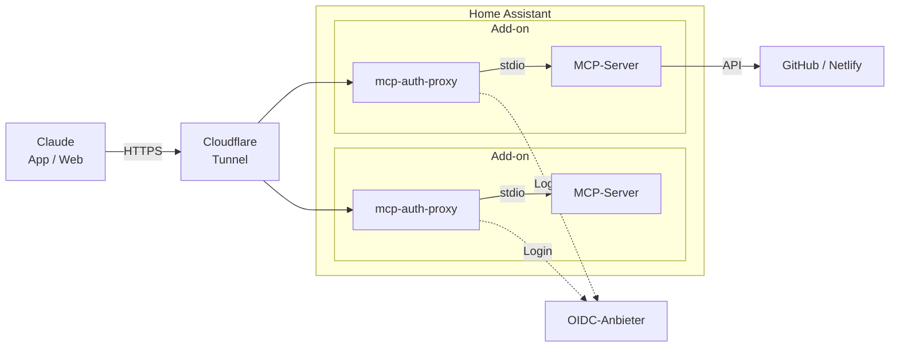

# MCP-Server für Claude als Home-Assistant-Add-ons

## Ziel

Claude soll auch unterwegs, aus der Smartphone-App heraus, mit eigenen Werkzeugen arbeiten:
Grafiken und PDFs bearbeiten, Code und Inhalte auf GitHub ändern, Websites über Netlify
veröffentlichen. Viele dieser Werkzeuge gibt es als MCP-Server, aber nur lokal über stdio.
Die Claude-App kann solche Server nicht starten. Sie braucht einen Remote-Server mit HTTPS
und OAuth-Login.

Dieses Repository macht aus stdio-MCP-Servern Remote-Connectoren, die dauerhaft auf einem
Home-Assistant-Gerät laufen (z. B. Raspberry Pi), sicher hinter einem Login stehen und sich
wie jedes andere Add-on installieren, konfigurieren, sichern und aktualisieren lassen.

## Funktionsumfang

| Add-on | MCP-Server | Wofür |
|---|---|---|
| [ArtCraft MCP](artcraft_mcp/DOCS.md) | VectorCraft, PhotoCraft, PdfCraft ([storytold](https://github.com/storytold)) | Vektorgrafik und Etiketten, Bildbearbeitung, PDFs prüfen und bearbeiten, in einem gemeinsamen Arbeitsordner unter `/share` |
| [Foto MCP](foto_mcp/DOCS.md) | eigener Server (Python, [OpenCV](https://opencv.org), [MediaPipe](https://ai.google.dev/edge/mediapipe)) | Fotos sichten, aussortieren, begradigen, motivgerecht zuschneiden, dezent retuschieren, im selben Arbeitsordner wie ArtCraft |
| [GitHub MCP](github_mcp/DOCS.md) | [github-mcp-server](https://github.com/github/github-mcp-server) (offiziell) | Repos lesen und ändern, Branches, Pull Requests, Issues, Actions, mit eigenem Token statt der GitHub-App |
| [Netlify MCP](netlify_mcp/DOCS.md) | [@netlify/mcp](https://www.npmjs.com/package/@netlify/mcp) (offiziell) | Sites, Deploys und Deploy Previews, Build-Logs, Umgebungsvariablen |

Jedes Add-on:

- **Login:** [mcp-auth-proxy](https://github.com/sigbit/mcp-auth-proxy) ist gegenüber Claude der
  OAuth-Server (Dynamic Client Registration) und lässt nur Nutzer durch, die sich bei einem
  OIDC-Anbieter wie Pocket ID anmelden.
- **Erreichbarkeit:** ein HTTPS-Hostname je MCP-Server, z. B. über das Cloudflared-Add-on. Keine
  offenen Ports nötig.
- **Konfiguration** im Home-Assistant-UI, Secrets als Passwortfelder, Proxy-Daten im Backup der App.
- **Feste Versionen** mit geprüften Prüfsummen. Ein täglicher Workflow prüft neue Releases, baut
  für aarch64 und amd64, startet jeden Server mit genau den Optionen des Add-ons (Selbsttest) und
  erhöht erst dann die Version. Home Assistant zeigt das Update an, installiert wird auf Klick.
- **Robust:** Stürzt ein Server ab, startet nur er neu. Das OIDC-Secret erreicht die MCP-Server nicht.

GitHub MCP und Netlify MCP zusammen ergeben einen Ablauf für die Pflege statischer Websites
durch Claude: Änderung als Pull Request, Prüfung in der Deploy Preview, Freigabe durch einen
Menschen. Beschrieben in [docs/WEBSITE-PFLEGE.md](docs/WEBSITE-PFLEGE.md).

## Installation

Oder von Hand: Einstellungen → Apps (Add-ons) → App Store → ⋮ → Repositories →
`https://github.com/kleinhansda/ha-mcp-addons`. Danach die gewünschten Add-ons einzeln
installieren. Einrichtung je Add-on in dessen `DOCS.md`, auch in Home Assistant sichtbar.

## Architektur

Warum Add-ons und nicht HACS, Portainer-Stacks, MCPHub oder die gehosteten Server der Anbieter:
[docs/ARCHITEKTUR.md](docs/ARCHITEKTUR.md).

## Aufbau des Repos

| Pfad | Inhalt |
|---|---|
| `<add-on>/config.yaml` | Name, Version, Optionen |
| `<add-on>/Dockerfile` | Image mit festen Versionen und Prüfsummen |
| `<add-on>/DOCS.md`, `CHANGELOG.md` | Einrichtung und Versionen, in Home Assistant sichtbar |
| `<add-on>/rootfs/usr/local/lib/mcp/services.sh` | Welche Server das Add-on startet, mit welchen Optionen und Ports |
| `common/run.sh`, `common/mcp-selftest` | Gemeinsames Startskript und Selbsttest. Kopien liegen in jedem Add-on, `.github/scripts/sync_common.py` gleicht sie ab |
| `.github/workflows/build.yml` | Baut und testet jedes Add-on auf beiden Architekturen |
| `.github/workflows/update.yml` | Prüft täglich neue Releases und trägt sie nach bestandenem Test ein |
| `docs/` | Hintergrund und Entscheidungen |

Ein weiterer stdio-MCP-Server wird zum Add-on, indem man einen Add-on-Ordner mit `config.yaml`,
`Dockerfile` und `services.sh` anlegt, `sync_common.py` ausführt und die Quelle in
`update_versions.py` einträgt.

## Hinweis

Inoffizielles Projekt, nicht mit Anthropic, GitHub, Google, Netlify, storytold oder sigbit verbunden.
Die MCP-Server stehen unter ihren eigenen Lizenzen, siehe deren Repositories.
