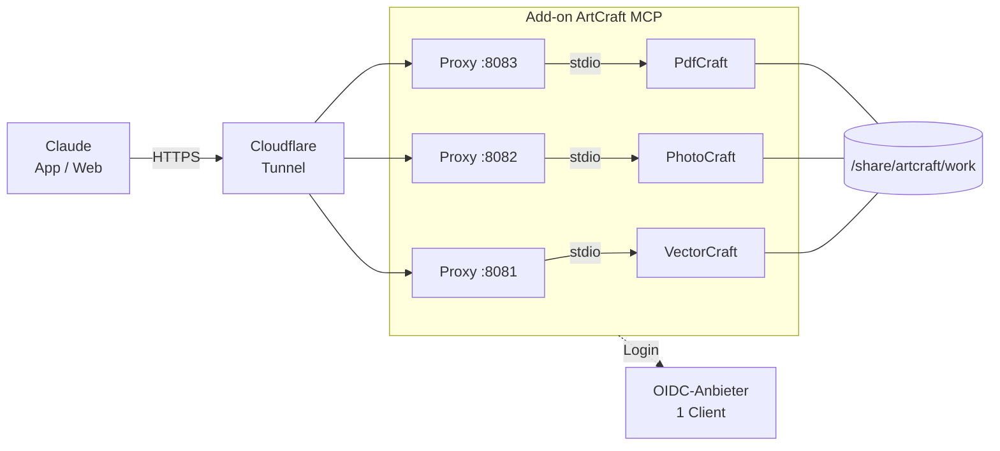

# ArtCraft

Hintergrund zum Add-on [ArtCraft MCP](../artcraft_mcp/DOCS.md): Apps im Vergleich, Testergebnisse,
Schriften, Entscheidungen und Beschreibungen für MCP-Verbindungen.

Das Add-on lag zwischenzeitlich in einem eigenen Repository (`kleinhansda/artcraft-mcp-ha`,
Versionen 1.1.0 bis 1.3.0) und ist mit 1.4.0 hierher zurückgekehrt. Umzug einer Installation von
dort: [DOCS, „Umzug aus artcraft-mcp-ha“](../artcraft_mcp/DOCS.md#umzug-aus-artcraft-mcp-ha).

## Apps im Vergleich

Die ArtCraft-Apps (storytold, Open Source, Rust) sind Nachbauten von Adobe- und Office-Programmen.
Jede CLI hat einen MCP-Server als Subcommand, alle sprechen nur stdio.

Tool-Zahlen gemessen am 2026-10-17 (VectorCraft 0.12.0, PhotoCraft 0.9.0, PdfCraft 0.8.0) und am
2026-10-18 mit 0.13.1, 0.10.0 und 0.9.0 bestätigt.

| App | Zweck | MCP-Befehl | Datei-Begrenzung | Tools |
|---|---|---|---|---|
| VectorCraft | Vektorgrafik (Illustrator) | `vectorcraft-cli mcp --headless` | `--automation-read-root`, `--automation-write-root` | 32 |
| PhotoCraft | Bildbearbeitung, PSD (Photoshop) | `photocraft-cli mcp` | wie VectorCraft | 25 |
| PdfCraft | PDFs (Acrobat) | `pdfcraft-cli mcp --root DIR --compact` | `--root` | 163, mit `--compact` 17 |
| LightCraft | Fotobibliothek, RAW (Lightroom) | `lightcraft-cli mcp [Bibliothek]` | nicht dokumentiert | ungeprüft |
| FilmCraft | Videoschnitt (Premiere) | `filmcraft-cli mcp` | nicht dokumentiert | ungeprüft |
| WordCraft | docx (Word) | `wordcraft-cli mcp` | nicht dokumentiert | ungeprüft |
| GridCraft | xlsx (Excel) | `gridcraft-cli mcp` | nicht dokumentiert | ungeprüft |

Im Add-on: VectorCraft, PhotoCraft und PdfCraft. Einzelne Dateien, Datei-Begrenzung vorhanden,
getestet.

- **LightCraft** arbeitet mit einer persistenten Bibliothek, nur mit Arbeitskopien sinnvoll.
- **FilmCraft** ist CPU-lastig und arbeitet mit großen Dateien, für kleine Geräte ungeeignet.
- **WordCraft und GridCraft** vorerst nicht, Claude erstellt docx und xlsx selbst.

## Testergebnisse

Getestet am 2026-10-17 in einer Linux-Umgebung ohne Display, mit den Release-Binaries (x86_64)
und mcp-auth-proxy 2.10.2:

- **Abhängigkeiten:** Die CLIs brauchen nur glibc ab 2.35, libgcc und libm, keine
  Grafikbibliotheken. Debian Bookworm (glibc 2.36) reicht, Alpine (musl) nicht.
- **aarch64:** Release-Pakete mit `SHA256SUMS.txt` vorhanden.
- **MCP-Handshake:** alle drei antworten auf `initialize` und `tools/list`.
- **VectorCraft:** Rechteck, Text mit Umlaut, PNG-Export und `save_file` funktionieren headless.
  Eine Schrift ist eingebaut. Weitere Schriften siehe [Schriften](#schriften).
- **Datei-Begrenzung greift:** Ein Export nach `/tmp` wurde mit „outside the write root“
  abgelehnt. PdfCraft meldet „outside the allowed directory“.
- **Home-Verzeichnis:** Die Apps schreiben nichts nach `$HOME`.
- **Proxy:** antwortet ohne Token mit 401 und liefert OAuth-Metadaten unter
  `/.well-known/oauth-authorization-server`.
- **Prozessmodell:** Der Proxy startet **einen** App-Prozess beim Start, nicht einen pro Sitzung.
  Das geöffnete Dokument bleibt zwischen Aufrufen erhalten, zwei Chats teilen sich dasselbe
  Dokument.

Am 2026-10-18 über Claude getestet (drei Connectoren, gemeinsamer Arbeitsordner): VectorCraft
schreibt eine PDF, PdfCraft liest Text samt Umlaut daraus und rendert die Seite, PhotoCraft legt
ein Bild an, exportiert und öffnet es wieder. PhotoCraft öffnet keine PDFs („unrecognized image
format“), das ist Aufgabe von PdfCraft.

Startskript des Add-ons am 2026-10-18 lokal getestet (x86_64, Test-OIDC-Anbieter): alle drei
Proxys liefern Metadaten und 401, ein beendeter App-Prozess startet nur diesen Dienst neu, SIGTERM
beendet alle Prozesse, das Client-Secret steht nicht in der Umgebung der Apps.

## Schriften

Geprüft am 2026-10-29 mit VectorCraft 0.18.0, PhotoCraft 0.17.0 und PdfCraft 0.15.0, am 2026-10-31 mit 0.19.0, 0.18.0 und 0.16.1 bestätigt (#1):

| App | Wo sie Schriften sucht |
|---|---|
| VectorCraft, PhotoCraft | `/usr/share/fonts` und die Ordner aus der fontconfig-Datei (`FONTCONFIG_FILE`, sonst `/etc/fonts/fonts.conf`). Mit eigener `FONTCONFIG_FILE` erscheinen deren Ordner zusätzlich in `text.fontList` bzw. `type.fonts` |
| PdfCraft | `text_font_files` durchsucht mit `--root` **nur** diesen Ordner, folgt keinen Symlinks, überspringt `.ttc` und Schriften ohne Einbettungsrecht. Kein zweiter Lese-Ordner möglich (`--automation-read-root` nur einmal) |

Folge für das Add-on:

- Das Image installiert `fonts-dejavu-core`, `fonts-liberation2`, `fonts-open-sans`, `fonts-lato`
  und `fonts-inter` aus Debian und behält je Familie nur Regular, Italic, Bold, BoldItalic
  (DejaVu ganz). 30 Dateien, ca. 12 MB statt 31 MB. Noto (`fonts-noto-core`, 42 MB) bewusst
  nicht, DejaVu deckt die üblichen Sonderzeichen ab.
- Beim Start kopiert `run.sh` (Funktion `schriften_einrichten` in `apps.sh`) die Dateien nach `<work_dir>/fonts/standard` (Option
  `fonts_to_work`), damit PdfCraft sie sieht. Eigene Schriften liegen in `<work_dir>/fonts`, eine
  generierte fontconfig-Datei macht den Ordner auch VectorCraft, PhotoCraft und den übrigen Apps bekannt.
- Alle 30 Dateien liefert `text_font_files`. Test mit DejaVu Sans: `text_font_import`,
  `text_edit` mit `font_resource`, speichern, `pdffonts` zeigt `emb yes`, Umlaute und `€` als Text
  extrahierbar. Der Selbsttest (`artcraft-selftest`) prüft beides im Build.
- Ein eigener Ordner `/share/artcraft/fonts` außerhalb des Arbeitsordners (Vorschlag aus #1)
  funktioniert für PdfCraft nicht, siehe oben.
- Mit PdfCraft 0.18.0 erneut geprüft (2026-11-04): `text_font_files` findet die Schriften,
  DejaVu Sans lässt sich einbetten. Die Schriften fehlten in `artcraft-mcp-ha` (1.1.0 bis 1.3.0)
  und sind mit 1.4.0 zurück.

## Architektur



### Warum ein Add-on und keine HACS-Integration

Eine HACS-Integration ist Python-Code im Home-Assistant-Core-Prozess. Der Core-Container basiert
auf Alpine (musl), die Release-Binaries brauchen glibc. Außerdem müsste die Integration vier
Prozesse aus dem Core starten, und ein hängendes PhotoCraft träfe Home Assistant selbst. Ein Add-on
ist ein eigener Container mit eigenem Basis-Image, Watchdog, Log und Backup.

### Warum ein Add-on mit drei Diensten

Ein Image, eine Konfiguration, ein OIDC-Client. Jeder Dienst hat seine eigene Neustart-Schleife,
ein Absturz trifft nur diese App. Alle drei teilen sich den Arbeitsordner.

### Warum drei Connectoren statt einem

In Claude wird pro Chat nur die App zugeschaltet, die gebraucht wird, und nur deren Tools belasten
den Kontext. Hängt eine App, bleiben die anderen nutzbar.

Geprüft und vorerst verworfen: ein Sammel-Server vor allen drei Apps. Alle drei haben gleichnamige
Tools (`command_run`, `doc_inspect`, `render_preview` …), der Sammel-Server muss also Präfixe setzen.

| Kandidat | Ergebnis |
|---|---|
| **1MCP** (`@1mcp/agent` 0.39.3, Node) | Über stdio getestet: 74 Tools mit Präfix, Aufrufe werden richtig weitergeleitet. `--enable-lazy-loading` startete im Test nicht |
| **mcpmux** (Go, v0.12.0) | Präfix `<backend>__<tool>`, ausgefallene Backends reißen die anderen nicht mit. Keine fertigen Binaries, nicht getestet |

Nachteile: alle Tools in jedem Chat, Node zusätzlich im Image, ein Ausfall trifft alle Apps.

### Warum ein Hostname je App

Der Proxy braucht `/.well-known`, `/.idp` und `/.auth` an der Wurzel. Pfade unter einem
gemeinsamen Hostnamen gehen deshalb nicht.

## Versionen und Updates

Das Dockerfile nennt feste Versionen. Home Assistant baut ein Add-on nur neu, wenn sich die
Add-on-Version ändert. Eine Logik „immer das neueste Release“ im Dockerfile würde deshalb nicht
greifen und Builds unvorhersehbar machen. Stattdessen prüft `update.yml` täglich die Releases,
baut beide Architekturen, führt `artcraft-selftest` aus und trägt die Versionen erst danach ein.

`artcraft-selftest` startet jede App mit exakt den Optionen aus `apps.sh` und erwartet eine
Antwort auf `tools/list`. Benennt ein Release eine Option um (`--headless`,
`--automation-read-root`, `--root`, `--compact`), beendet sich die App mit einer Fehlermeldung,
und das Update wird nicht eingetragen.

## Ressourcen

Gemessen am 2026-10-17 auf x86 (Xeon 2,1 GHz):

| App und Aufgabe | Speicher | Zeit x86 | Schätzung Raspberry Pi 4 |
|---|---|---|---|
| Alle drei im Leerlauf | je ca. 10 MB | | |
| VectorCraft: Datei öffnen, Vorschau, PDF-Export | 29 MB | 1,2 s + 0,2 s + 0,1 s | wenige Sekunden |
| PhotoCraft: 24-MP-Foto öffnen, Weichzeichner, JPG-Export | 475 MB Spitze | 1,6 s + 1,3 s + 0,4 s | ca. 10 bis 20 s |
| PdfCraft: PDF öffnen | 12 MB | 0,3 s | ca. 1 s |

Die Werte für den Raspberry Pi sind geschätzt (Faktor 4 bis 6), nicht gemessen.

## Interner Zugriff ohne Login (1.3.0)

Anlass: Open WebUI läuft als App auf demselben Home Assistant und soll die Apps ohne Umweg über
Cloudflare und OIDC nutzen.

- **mcp-auth-proxy 2.10.2 hat keinen Modus ohne Login.** Ohne Anbieter und Passwort antwortet er
  auf `/mcp` mit 401 (getestet 2026-11-03). Ein Passwort statt OIDC hilft nicht, Open WebUI müsste
  dann den OAuth-Ablauf des Proxys durchlaufen.
- **Gewählt: eigene Brücke `mcp_bridge.py`** (nur Standardbibliothek, wie `files_mcp.py`) statt
  supergateway (bräuchte Node.js im Image) oder mcp-proxy (zusätzliche Python-Pakete).
  Antworten als JSON, GET öffnet einen leeren SSE-Kanal mit Keepalive. Mit 405 verbindet sich das
  MCP-SDK 2.x jede Sekunde neu.
- **Getestet** mit dem offiziellen MCP-Python-SDK 1.30 und 2.3 (initialize, tools/list, tools/call,
  zwei Clients parallel) und im Selbsttest mit dem Dateien-Server.
- Eigene Ports 9081 bis 9090 statt derselben wie öffentlich: Beide Zugänge können gleichzeitig
  laufen, und die Adresse in Open WebUI bleibt gleich, wenn später eine öffentliche URL dazukommt.
- Die Ports stehen nicht in `config.yaml`, damit sie nie auf den Host gelegt werden.
- Schutz gegen DNS-Rebinding: Requests mit `Origin`-Header werden abgelehnt (Open WebUI ruft
  serverseitig ohne `Origin` auf).

## Offene Punkte

- [ ] Echte Rechenzeiten auf aarch64 messen und hier eintragen
- [ ] Liste der zu blockenden UI-Tools mit neuen App-Versionen abgleichen
- [ ] LightCraft aufnehmen? Nur mit Arbeitskopien einer Bibliothek

## Quellen

- https://github.com/storytold/vectorcraft, https://github.com/storytold/photocraft,
  https://github.com/storytold/pdfcraft (Releases)
- https://github.com/sigbit/mcp-auth-proxy (README, `--help`)
- https://developers.home-assistant.io/docs/apps/configuration (Add-on-Konfiguration)
- https://github.com/1mcp-app/agent, https://github.com/toabctl/mcpmux (Variante ein Connector)

## Beschreibungen für MCP-Verbindungen

Texte zum Einfügen in das Feld **Beschreibung** einer MCP-Verbindung (Open WebUI) oder eines
Connectors. Das Modell liest sie, um zu entscheiden, welches Werkzeug es nutzt. Pfade gelten für
den Standard-Arbeitsordner `/share/artcraft/work`, bei anderem `work_dir` anpassen.

Die **Filterliste** blendet Tools aus, die nur mit der Desktop-App funktionieren (im Add-on läuft
keine Oberfläche). In Open WebUI ins Feld *Filterliste für Funktionsnamen* eintragen. Ob `!` dort
ausschließt, im Tooltip prüfen, sonst die Tools im Modell abwählen.

Tool-Listen geprüft am 2026-11-03 mit den Versionen aus Add-on 1.3.0.

### VectorCraft (`craft-vector`, Port 9081)

```
VectorCraft: Vektorgrafik wie Illustrator, z. B. Etiketten, Logos, Flyer. Dokumente öffnen (svg, pdf, ai, png, jpg), Formen, Pfade, Text, Effekte und Pathfinder anwenden, mit render_preview prüfen, mit save_file oder export (svg, pdf, png) sichern. Dateien nur unter /share/artcraft/work. Ein geöffnetes Dokument für alle Chats, Ergebnisse immer speichern. Weitere Befehle über list_commands und run_command.
```

Filterliste: `!ui_inspect, !ui_screenshot, !inspect_ui, !select_tool, !pointer_gesture, !press_key, !type_text, !answer_dialog, !invoke_menu, !open_panel`

### PhotoCraft (`craft-photo`, Port 9082)

```
PhotoCraft: Bildbearbeitung wie Photoshop. Bilder und PSD öffnen (doc_open), Ebenen, Filter, Korrekturen und Zuschnitt über command_run und command_list, Ergebnis mit doc_render_preview prüfen, mit doc_save oder doc_export (png, jpg, webp, tif, psd) sichern. Lange Filter laufen als Job (jobs_list). Dateien nur unter /share/artcraft/work. Öffnet keine PDFs, dafür PdfCraft.
```

Filterliste: `!control_call, !ui_inspect, !ui_menu_invoke, !ui_pointer, !ui_screenshot, !ui_set`

### PdfCraft (`craft-pdf`, Port 9083)

```
PdfCraft: PDFs öffnen, lesen, durchsuchen, bearbeiten, zusammenführen und aufteilen. Text mit text_extract und text_find, Seiten mit page_render ansehen, Dateien mit doc_combine (auch Bilder) und doc_split. Über 160 weitere Funktionen (Formulare, Kommentare, Seiten drehen, schwärzen, komprimieren …) mit tool_search finden und mit tool_call ausführen. Dateien nur unter /share/artcraft/work.
```

### Dateien

Seit ArtCraft 1.4.9 die eigene App Files MCP (`files_mcp/`), siehe deren DOCS.md.

### CADCraft (`craft-cad`, Port 9085)

```
CADCraft: 2D-CAD wie AutoCAD. DXF und DWG öffnen oder neue Zeichnung anlegen, zeichnen über command_line (Eingaben wie an der AutoCAD-Befehlszeile) oder script, Inhalt mit inspect_drawing, query_entities und find_text lesen, mit render als PNG prüfen, mit save als DXF, DWG, SVG, PNG oder PDF sichern. Achtung: nicht auf den Arbeitsordner begrenzt.
```

### WordCraft (`craft-word`, Port 9086)

```
WordCraft: Textverarbeitung wie Word. Dokumente anlegen (leer, Brief, Lebenslauf, Bericht) oder öffnen (docx, doc, odt, rtf, md, html, txt), Text schreiben mit type_text, formatieren und einfügen über execute und list_commands, mit render_page prüfen, mit save_document als docx, pdf, odt, md oder html sichern. Dateien nur unter /share/artcraft/work.
```

Filterliste: `!screenshot, !click, !key, !ui_inspect`

### DeckCraft (`craft-deck`, Port 9087)

```
DeckCraft: Präsentationen wie PowerPoint. Neue Präsentation mit Theme anlegen oder pptx öffnen, Folien mit add_slide, Text mit add_text_box und set_text, Bilder, Tabellen und Diagramme einfügen, mit render_slide prüfen, als pptx speichern oder als pdf und png exportieren. Alles Weitere über run_command und list_commands. Dateien nur unter /share/artcraft/work.
```

Filterliste: `!pointer, !select_tool, !key, !screenshot, !call_app`

### GridCraft (`craft-grid`, Port 9088)

```
GridCraft: Tabellenkalkulation wie Excel. Arbeitsmappen öffnen (xlsx, xls, ods, csv) oder neu anlegen, Werte mit read_range und write_range, Formeln mit set_cell, Formeln testen mit evaluate_formula, formatieren, sortieren, filtern, Tabellen und Diagramme anlegen, mit save_workbook sichern (xlsx, csv). Weitere Befehle über execute_command. Achtung: nicht auf den Arbeitsordner begrenzt.
```

Filterliste: `!screenshot`

### FigCraft (`craft-fig`, Port 9089)

```
FigCraft: Interface-Design wie Figma. Dokumente öffnen (figcraft, fig, sketch) oder Ebenen mit create_node anlegen und mit set_properties gestalten, Struktur mit inspect_document lesen, Entwurf mit screenshot ansehen, mit export als png, svg, jpg oder pdf ausgeben, mit save_file sichern. Weitere Befehle über run_command. Dateien nur unter /share/artcraft/work.
```

Filterliste: `!pointer, !key, !inspect_ui, !wait_for_changes`

### Craft Anything (`craft-anything`, Port 9090)

```
Craft Anything: Reverse Engineering und Nachbau von Programmen und Dateien mit lückenloser Beweisführung. Ziel öffnen, Brief und Plan schreiben, Hypothesen und Befunde mit Belegen festhalten, offene Fragen als Unknowns führen, Bericht erzeugen. Zusätzliche Werkzeuge (native code, Android, Web, Electron) mit list_toolsets und enable_toolset zuschalten. Achtung: nicht auf den Arbeitsordner begrenzt.
```

Filterliste: `!core_person_ask, !core_action_approve`. Die Tools `assets_image_generate` und
`assets_model_generate` brauchen einen fal.ai-Schlüssel, ohne ihn ebenfalls ausblenden.
