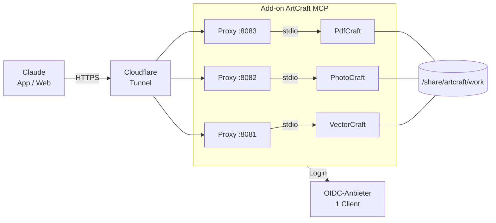

# ArtCraft: Hintergrund

Hintergrund zum Add-on: was getestet wurde, was entschieden wurde und warum.
Bedienung steht in [artcraft_mcp/DOCS.md](../artcraft_mcp/DOCS.md), das gemeinsame Muster in [ARCHITEKTUR.md](ARCHITEKTUR.md).

## Apps im Vergleich

Die ArtCraft-Apps (storytold, Open Source, Rust) sind Nachbauten von Adobe- und Office-Programmen.
Jede CLI hat einen MCP-Server als Subcommand, alle sprechen nur stdio.

Tool-Zahlen gemessen am 2026-10-17 (VectorCraft 0.12.0, PhotoCraft 0.9.0, PdfCraft 0.8.0) und am
2026-10-18 mit 0.13.1, 0.10.0 und 0.9.0 bestätigt.

| App | Zweck | MCP-Befehl | Datei-Begrenzung | Tools |
|---|---|---|---|---|
| VectorCraft | Vektorgrafik (Illustrator) | `vectorcraft-cli mcp --headless` | `--automation-read-root`, `--automation-write-root` | 32 |
| PhotoCraft | Bildbearbeitung, PSD (Photoshop) | `photocraft-cli mcp` | wie VectorCraft | 25 |
| PdfCraft | PDFs (Acrobat) | `pdfcraft-cli mcp --root DIR --compact` | `--root` | 163, mit `--compact` 17 |
| LightCraft | Fotobibliothek, RAW (Lightroom) | `lightcraft-cli mcp [Bibliothek]` | nicht dokumentiert | ungeprüft |
| FilmCraft | Videoschnitt (Premiere) | `filmcraft-cli mcp` | nicht dokumentiert | ungeprüft |
| WordCraft | docx (Word) | `wordcraft-cli mcp` | nicht dokumentiert | ungeprüft |
| GridCraft | xlsx (Excel) | `gridcraft-cli mcp` | nicht dokumentiert | ungeprüft |

Im Add-on: VectorCraft, PhotoCraft und PdfCraft. Einzelne Dateien, Datei-Begrenzung vorhanden,
getestet.

- **LightCraft** arbeitet mit einer persistenten Bibliothek, nur mit Arbeitskopien sinnvoll.
- **FilmCraft** ist CPU-lastig und arbeitet mit großen Dateien, für kleine Geräte ungeeignet.
- **WordCraft und GridCraft** vorerst nicht, Claude erstellt docx und xlsx selbst.

## Testergebnisse

Getestet am 2026-10-17 in einer Linux-Umgebung ohne Display, mit den Release-Binaries (x86_64)
und mcp-auth-proxy 2.10.2:

- **Abhängigkeiten:** Die CLIs brauchen nur glibc ab 2.35, libgcc und libm, keine
  Grafikbibliotheken. Debian Bookworm (glibc 2.36) reicht, Alpine (musl) nicht.
- **aarch64:** Release-Pakete mit `SHA256SUMS.txt` vorhanden.
- **MCP-Handshake:** alle drei antworten auf `initialize` und `tools/list`.
- **VectorCraft:** Rechteck, Text mit Umlaut, PNG-Export und `save_file` funktionieren headless.
  Eine Schrift ist eingebaut. Für andere Schriften siehe [Schriften](#schriften).
- **Datei-Begrenzung greift:** Ein Export nach `/tmp` wurde mit „outside the write root“
  abgelehnt. PdfCraft meldet „outside the allowed directory“.
- **Home-Verzeichnis:** Die Apps schreiben nichts nach `$HOME`.
- **Proxy:** antwortet ohne Token mit 401 und liefert OAuth-Metadaten unter
  `/.well-known/oauth-authorization-server`.
- **Prozessmodell:** Der Proxy startet **einen** App-Prozess beim Start, nicht einen pro Sitzung.
  Das geöffnete Dokument bleibt zwischen Aufrufen erhalten, zwei Chats teilen sich dasselbe
  Dokument.

Am 2026-10-18 über Claude getestet (drei Connectoren, gemeinsamer Arbeitsordner): VectorCraft
schreibt eine PDF, PdfCraft liest Text samt Umlaut daraus und rendert die Seite, PhotoCraft legt
ein Bild an, exportiert und öffnet es wieder. PhotoCraft öffnet keine PDFs („unrecognized image
format“), das ist Aufgabe von PdfCraft.

Startskript des Add-ons am 2026-10-18 lokal getestet (x86_64, Test-OIDC-Anbieter): alle drei
Proxys liefern Metadaten und 401, ein beendeter App-Prozess startet nur diesen Dienst neu, SIGTERM
beendet alle Prozesse, das Client-Secret steht nicht in der Umgebung der Apps.

## Schriften

Geprüft am 2026-10-29 mit VectorCraft 0.18.0, PhotoCraft 0.17.0 und PdfCraft 0.15.0, am 2026-10-31 mit 0.19.0, 0.18.0 und 0.16.1 bestätigt (#1):

| App | Wo sie Schriften sucht |
|---|---|
| VectorCraft, PhotoCraft | `/usr/share/fonts` und die Ordner aus der fontconfig-Datei (`FONTCONFIG_FILE`, sonst `/etc/fonts/fonts.conf`). Mit eigener `FONTCONFIG_FILE` erscheinen deren Ordner zusätzlich in `text.fontList` bzw. `type.fonts` |
| PdfCraft | `text_font_files` durchsucht mit `--root` **nur** diesen Ordner, folgt keinen Symlinks, überspringt `.ttc` und Schriften ohne Einbettungsrecht. Kein zweiter Lese-Ordner möglich (`--automation-read-root` nur einmal) |

Folge für das Add-on:

- Das Image installiert `fonts-dejavu-core`, `fonts-liberation2`, `fonts-open-sans`, `fonts-lato`
  und `fonts-inter` aus Debian und behält je Familie nur Regular, Italic, Bold, BoldItalic
  (DejaVu ganz). 30 Dateien, ca. 12 MB statt 31 MB. Noto (`fonts-noto-core`, 42 MB) bewusst
  nicht, DejaVu deckt die üblichen Sonderzeichen ab.
- Beim Start kopiert `services.sh` die Dateien nach `<work_dir>/fonts/standard` (Option
  `fonts_to_work`), damit PdfCraft sie sieht. Eigene Schriften liegen in `<work_dir>/fonts`, eine
  generierte fontconfig-Datei macht den Ordner auch VectorCraft und PhotoCraft bekannt.
- Alle 30 Dateien liefert `text_font_files`. Test mit DejaVu Sans: `text_font_import`,
  `text_edit` mit `font_resource`, speichern, `pdffonts` zeigt `emb yes`, Umlaute und `€` als Text
  extrahierbar. `mcp-selftest` prüft beides im Build.
- Ein eigener Ordner `/share/artcraft/fonts` außerhalb des Arbeitsordners (Vorschlag aus #1)
  funktioniert für PdfCraft nicht, siehe oben.

## Architektur

### Warum ein Add-on und keine HACS-Integration

Eine HACS-Integration ist Python-Code im Home-Assistant-Core-Prozess. Der Core-Container basiert
auf Alpine (musl), die Release-Binaries brauchen glibc. Außerdem müsste die Integration vier
Prozesse aus dem Core starten, und ein hängendes PhotoCraft träfe Home Assistant selbst. Ein Add-on
ist ein eigener Container mit eigenem Basis-Image, Watchdog, Log und Backup.

### Warum ein Add-on mit drei Diensten

Ein Image, eine Konfiguration, ein OIDC-Client. Jeder Dienst hat seine eigene Neustart-Schleife,
ein Absturz trifft nur diese App. Alle drei teilen sich den Arbeitsordner.

### Warum drei Connectoren statt einem

In Claude wird pro Chat nur die App zugeschaltet, die gebraucht wird, und nur deren Tools belasten
den Kontext. Hängt eine App, bleiben die anderen nutzbar.

Geprüft und vorerst verworfen: ein Sammel-Server vor allen drei Apps. Alle drei haben gleichnamige
Tools (`command_run`, `doc_inspect`, `render_preview` …), der Sammel-Server muss also Präfixe setzen.

| Kandidat | Ergebnis |
|---|---|
| **1MCP** (`@1mcp/agent` 0.39.3, Node) | Über stdio getestet: 74 Tools mit Präfix, Aufrufe werden richtig weitergeleitet. `--enable-lazy-loading` startete im Test nicht |
| **mcpmux** (Go, v0.12.0) | Präfix `<backend>__<tool>`, ausgefallene Backends reißen die anderen nicht mit. Keine fertigen Binaries, nicht getestet |

Nachteile: alle Tools in jedem Chat, Node zusätzlich im Image, ein Ausfall trifft alle Apps.

### Warum ein Hostname je App

Der Proxy braucht `/.well-known`, `/.idp` und `/.auth` an der Wurzel. Pfade unter einem
gemeinsamen Hostnamen gehen deshalb nicht.

## Versionen und Updates

Das Dockerfile nennt feste Versionen. Home Assistant baut ein Add-on nur neu, wenn sich die
Add-on-Version ändert. Eine Logik „immer das neueste Release“ im Dockerfile würde deshalb nicht
greifen und Builds unvorhersehbar machen. Stattdessen prüft `update.yml` täglich die Releases,
baut beide Architekturen, führt `mcp-selftest` aus und trägt die Versionen erst danach ein.

`mcp-selftest` startet jede App mit exakt den Optionen aus `services.sh` und erwartet eine
Antwort auf `tools/list`. Benennt ein Release eine Option um (`--headless`,
`--automation-read-root`, `--root`, `--compact`), beendet sich die App mit einer Fehlermeldung,
und das Update wird nicht eingetragen.

## Ressourcen

Gemessen am 2026-10-17 auf x86 (Xeon 2,1 GHz):

| App und Aufgabe | Speicher | Zeit x86 | Schätzung Raspberry Pi 4 |
|---|---|---|---|
| Alle drei im Leerlauf | je ca. 10 MB | | |
| VectorCraft: Datei öffnen, Vorschau, PDF-Export | 29 MB | 1,2 s + 0,2 s + 0,1 s | wenige Sekunden |
| PhotoCraft: 24-MP-Foto öffnen, Weichzeichner, JPG-Export | 475 MB Spitze | 1,6 s + 1,3 s + 0,4 s | ca. 10 bis 20 s |
| PdfCraft: PDF öffnen | 12 MB | 0,3 s | ca. 1 s |

Die Werte für den Raspberry Pi sind geschätzt (Faktor 4 bis 6), nicht gemessen.

## Offene Punkte

- [ ] Echte Rechenzeiten auf aarch64 messen und hier eintragen
- [ ] Liste der zu blockenden UI-Tools mit neuen App-Versionen abgleichen
- [ ] LightCraft aufnehmen? Stand 0.15.0 (2026-10-29): `lightcraft-cli mcp [--library DIR] [--compact] [Dateien…]`,
  369 Befehle, darunter hilfreich zum Aussortieren `library.findSimilar`, `stack.auto`, `photo.pick`/`reject`,
  `photo.readFocusPoints`, `crop.autoStraighten`, `develop.auto`, `develop.autoBwMix`, `faces.*`.
  **Keine Datei-Begrenzung** (kein `--root`/`--automation-*-root`): Über den Connector könnte die App
  alles im Container lesen und schreiben, auch `/data` mit den Proxy-Schlüsseln. Erst aufnehmen, wenn
  LightCraft eine Begrenzung bekommt oder der Dienst als eigener Nutzer nur auf `work_dir` zugreifen kann

## Quellen

- https://github.com/storytold/vectorcraft, https://github.com/storytold/photocraft,
  https://github.com/storytold/pdfcraft (Releases)
- https://github.com/sigbit/mcp-auth-proxy (README, `--help`)
- https://developers.home-assistant.io/docs/apps/configuration (Add-on-Konfiguration)
- https://github.com/1mcp-app/agent, https://github.com/toabctl/mcpmux (Variante ein Connector)
