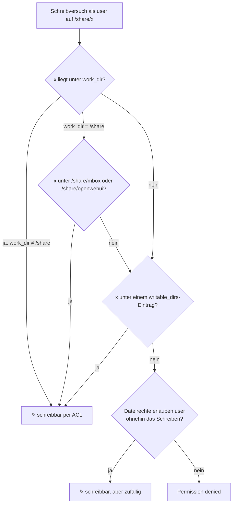

# Open Terminal

[Open Terminal](https://github.com/open-webui/open-terminal) gibt Modellen in Open WebUI eine
Shell mit Dateien und Werkzeugen: Code ausführen, Dateien erzeugen und umwandeln (PDF, Word,
Excel, Bilder, Audio), Daten auswerten. Die Dateien erscheinen im Chat im Reiter „Dateien“.

Die App nutzt das offizielle Image (volle Variante mit Python-Datenpaketen, Node.js,
LibreOffice, Pandoc, LaTeX und ffmpeg, rund 4 GB), ergänzt um R (siehe [R](#r)), und läuft in
einem eigenen Container.
Befehle des Modells kommen so nicht an Datenbank und Schlüssel von Open WebUI.

## Einrichtung mit der App Open WebUI

1. **Open Terminal** installieren und starten.
2. Im Protokoll steht `API-Schlüssel (…): <schlüssel>`. Den Wert kopieren.
3. In der App **Open WebUI** unter Konfiguration bei `open_terminal_api_key` einfügen und
   Open WebUI neu starten.

Open WebUI trägt die Verbindung dann selbst ein (Admin-Bereich → Integrationen → Open
Terminal). Sie ist zunächst nur für Admins nutzbar. Andere Nutzer oder Gruppen gibst du dort
frei; die Freigaben bleiben bei Neustarts erhalten.

Im Chat wählst du das Terminal aus einer Auswahlliste; danach erscheint in der Seitenleiste des
Chats der Reiter „Dateien“.

## R

R kommt aus Debian (R 4.5) mit fertigen Binärpaketen, auch auf arm64:

- `r-recommended` (MASS, Matrix, survival …), tidyverse, data.table, renv, rmarkdown, knitr,
  readxl, writexl, openxlsx. Pandoc und LaTeX für rmarkdown bringt das Image mit.
- R-Kernel für Jupyter (`ir`), falls Debian IRkernel führt.
- `Rscript` und `R` im Terminal, CRAN (`cloud.r-project.org`) ist ohne Rückfrage eingestellt.

Weitere Pakete:

| Weg | Ziel | Bei Updates der App |
|---|---|---|
| `install.packages("x")` | `~/R/library` unter `/data/home` | bleibt erhalten, im Backup |
| `sudo apt-get install r-cran-x` | System-Bibliothek im Image | geht verloren |
| renv im Projekt | `renv/library` im Projekt, Cache unter `~/.cache/R/renv` | bleibt erhalten, Cache nicht im Backup |

`install.packages()` baut aus den Quellen; bei Paketen mit C/C++-Code (z. B. `arrow`, `sf`)
dauert das lange. Fehlt dafür eine
Systembibliothek, hilft `sudo apt-get install lib…-dev`, die ist nach einem Update aber wieder weg.
Nach dem Zurückspielen eines Backups in renv-Projekten `renv::restore()` ausführen, weil der
Cache nicht gesichert wird.

## Pfade und Schreibrechte

Kurz: `/share` ist **lesbar**, aber nicht automatisch beschreibbar. Schreiben darf das Terminal
nur in Ordner, die die App beim Start freigibt. Diese Ordner liegen **in** `/share`, nicht
daneben.

### Wer schreibt

Befehle des Modells laufen als Linux-Konto `user` (UID 1000), nicht als root. Die Dateien unter
`/share` gehören meist root, weil andere Apps (Paperless, Files MCP, ArtCraft …) sie als root
anlegen. Für `user` sind sie daher nur lesbar. Die App gibt `user` gezielt Schreibrecht per
**ACL** (`setfacl -R`, mit Vorgabe-ACL, damit es auch für später angelegte Dateien gilt).

### Welche Ordner beschreibbar sind

| Quelle | Freigegeben | Beispiel |
|---|---|---|
| `work_dir` ist ein Unterordner, z. B. `/share/artcraft/work` (Standard) | der ganze Arbeitsordner | `/share/artcraft/work/**` |
| `work_dir` ist `/share` selbst | **nur** die Austauschordner, nicht ganz `/share` (Schutz der Daten anderer Apps) | `/share/mbox/**`, `/share/openwebui/**` |
| `writable_dirs` (relativ zu `/share`) | jeder Eintrag als `/share/<eintrag>`, legt den Ordner an, falls er fehlt | `repos` → `/share/repos/**` |
| Mehrbenutzer, Familienordner | `/share/<family_dir>` für alle Konten | `/share/familie/**` |

`~/work` ist nur ein Link auf `work_dir`. Das Schreibrecht hängt am Ordner, nicht am Link.

```
/share                          lesbar  (Beispiel: work_dir = /share, writable_dirs = repos, dokumente)
├── mbox/                       ✎ Austausch Mail (immer, per ACL)
│   ├── inbox/  outbox/
├── openwebui/                  ✎ Austausch Chat-Anhänge (immer, per ACL)
│   └── inbox/
├── repos/                      ✎ writable_dirs: repos
├── dokumente/                  ✎ writable_dirs: dokumente
├── owuiusers/                  ✎ family_dir (nur Mehrbenutzer)
├── paperless/                  nur lesen
├── artcraft/                   nur lesen (außer als work_dir)
└── syncthing/obsidian_vault/   nur lesen, außer die Dateirechte erlauben es ohnehin (siehe unten)
```



**„Zufällig schreibbar“:** Gehören Dateien der UID 1000 oder sind sie für alle beschreibbar,
darf `user` dort schreiben, ohne dass die App etwas freigibt. Das trifft oft Ordner, die eine
andere App mit UID 1000 anlegt (z. B. Syncthing). Darauf nicht verlassen: Ordner, in die
Modelle schreiben sollen, unter `writable_dirs` eintragen. Prüfen im Terminal:
`stat -c '%U %a' /share/<ordner>` und `getfacl /share/<ordner>`.

### Was die Freigabe nicht ist

Die ACLs sind eine **Leitplanke, keine Sicherheitsgrenze**: `user` darf `sudo` ohne Passwort
und kommt damit an alles unter `/share` (siehe [Was das Modell darf](#was-das-modell-darf)).
Sie verhindern, dass ein Modell versehentlich in fremde Daten schreibt; Modelle sollen
`Permission denied` melden statt `sudo` zu nutzen.

Andere Apps wie **Files MCP** schreiben in ihrem eigenen Container als root und damit überall in
`/share` (mit ihren eigenen Sperren). Deshalb kann ein Modell über files eine Datei ändern, die
das Terminal nicht ändern darf.

### Mehrbenutzer

| Konto | Schreibrecht unter `/share` |
|---|---|
| Administratoren (`admin_users`) | wie `user`: alle Ordner aus der Tabelle oben |
| alle anderen | nur der Familienordner; alles andere direkt unter `/share` gesperrt (auch nicht lesbar) |

### Austausch und Aufräumen

- Austauschordner `mbox/inbox`, `mbox/outbox` (Mail) und `openwebui/inbox` (Anhänge aus dem
  Chat) unter `work_dir` legt die App beim Start an.
- Aufgeräumt wird nicht von dieser App, sondern von Home Assistant (Pyscript
  `work_cleanup.py`, siehe Repository-README).
- Die ACLs bleiben nach dem Entfernen eines `writable_dirs`-Eintrags stehen; entfernen mit
  `sudo setfacl -R -x u:user -x d:u:user /share/<ordner>`.

## Was das Modell darf

- Alles, was ein Nutzer mit `sudo` im Container darf: Pakete installieren, Dateien anlegen
  und löschen, ins Internet verbinden.
- **Ganz `/share`**, nicht nur den Arbeitsordner: Home Assistant kann `/share` nur komplett
  einbinden, und mit `sudo` gelten keine Dateirechte. Dazu gehören z. B. Syncthing-Ordner
  oder Paperless-Daten. Deshalb: Terminal nur für Admins freigeben, in Open WebUI
  „Um Bestätigung bitten“ für Werkzeuge nutzen und `/share` sichern. Mit leerem `work_dir`
  bleibt `/share` eingebunden, aber ohne Link.
- **Nicht**: an `/config`, die Datenbank oder Schlüssel von Open WebUI. Das Token des
  Supervisors wird vor dem Start entfernt.
- Erreichbar ist die App nur im internen Netz der Apps (`http://<repo-hash>-open-terminal:8000`),
  nicht von außen, solange der Port leer bleibt.

## Optionen

| Option | Bedeutung |
|---|---|
| `api_key` | Leer = beim ersten Start erzeugt und in `/data/api_key` gespeichert. Eigener Wert möglich; dann in Open WebUI denselben eintragen |
| `work_dir` | Arbeitsordner unter `/share`, im Terminal als `~/work`. Leer = kein Link |
| `writable_dirs` | Ordner relativ zu `/share`, in die das Terminal zusätzlich schreiben darf, siehe [Pfade und Schreibrechte](#pfade-und-schreibrechte) |
| `multi_user`, `admin_users`, `family_dir` | Mehrbenutzer, siehe [Mehrbenutzer](#mehrbenutzer-familie) |
| `webdav` | WebDAV-Ziel für rclone, siehe [WebDAV](#webdav-nur-administratoren) |

## Daten und Backup

Das Home-Verzeichnis des Terminals liegt in `/data/home`. Dateien und mit `pip install --user`
oder `npm` nachinstallierte Pakete bleiben bei Updates erhalten und sind im Backup der App,
ohne `.cache` und `.npm`. Mit `sudo apt install` installierte Pakete gehen beim Update
verloren.

## Updates

Die Version ist fest (`OPEN_TERMINAL_VERSION` im Dockerfile). Ein täglicher Workflow prüft
neue Releases, baut und testet die App zusammen mit Open WebUI und trägt
die Version erst danach ein. Home Assistant zeigt dann das Update an. Die Add-on-Version folgt
der Version von Open Terminal, eigene Änderungen hängen `-1`, `-2` … an. Open WebUI am besten
zusammen aktualisieren.

## Python- und R-Pakete

Statt eigener Werkzeuge pro Programm arbeiten Modelle hier mit den Bibliotheken, die sie gut
kennen. Die App installiert sie beim Start im Hintergrund (Protokoll: `[pakete] …`, am Ende
`Pakete bereit`):

| Gruppe | Pakete |
|---|---|
| `bild` | Pillow, pillow-heif, OpenCV (headless), scikit-image, imageio, rawpy |
| `vektor` | drawsvg, svgwrite, svgelements, CairoSVG, ReportLab, fonttools, qrcode, python-barcode |
| `pdf` | pypdf, pikepdf, PyMuPDF, pdfplumber |
| `office` | python-docx, docxtpl, python-pptx, openpyxl, XlsxWriter, Markdown, MarkItDown (`markitdown datei.pptx` → Markdown für PDF, Word, PowerPoint, Excel, Outlook-.msg) |
| `cad` | ezdxf, shapely, matplotlib |
| `3d` | trimesh, numpy-stl, manifold3d, build123d (CAD auf OpenCascade, Export STEP/STL/3MF; ca. 60 MB) |

Schon im Image: numpy, pandas, matplotlib, plotly, LibreOffice (z. B. `soffice --headless
--convert-to pdf`), Pandoc, ImageMagick, ffmpeg, Poppler, LaTeX, R mit tidyverse.

- Die Pakete liegen in `~/.venv` (uv, mit Zugriff auf die Pakete des Images). `python`, `pip`
  und Jupyter im Terminal nutzen diese Umgebung.
- `update_packages` an: jeder Start holt die neuesten Versionen. Vorher wird der Stand in
  `~/.venv/staende/<Datum>.txt` gesichert (die letzten 10). Bricht ein Update etwas, zurück mit
  `uv pip sync --python ~/.venv/bin/python ~/.venv/staende/<Datum>.txt`.
  ⚠️ `sync` entfernt dabei alle Pakete in `~/.venv`, die nicht in der Datei stehen.
- Einzelne Versionen festhalten: unter `python_packages` mit Version, z. B. `pandas==2.2.3`.
- Von Hand neu installieren oder aktualisieren: `terminal-pakete`.
- R-Pakete aus `r_packages` werden aus den Quellen kompiliert. Der erste Start kann dann
  deutlich länger dauern.

## Vorlagen

Unter `~/vorlagen` (im Image `/usr/local/share/vorlagen`, nur lesen) liegen getestete Skripte als
Ausgangspunkt für Modelle, z. B. `3d/teil.py`. In den Projektordner kopieren und dort anpassen.


## Dokumente im einheitlichen Look (`dokument`)

`dokument` macht aus Markdown mit YAML-Kopf fertig gestaltete Dateien: PDF (Pandoc → Typst),
Word (Pandoc mit Referenzdokument) und HTML. Vorlagen, Schriften und Beispiele liegen unter
`/usr/local/share/dokumente` (nur lesen).

```bash
dokument brief.md                              # PDF neben der Eingabe
dokument bericht.md -f pdf,docx,html --vorschau
dokument brief.md --absender david             # Absender aus /share/dokumente/absender/david.yaml
dokument --liste
```

| Art | Inhalt |
|---|---|
| `brief` | DIN 5008 Form B: Anschriftfeld für Fensterumschläge (45 mm von oben, 20 mm von links, 85 × 45 mm), Rücksendezeile, Informationsblock, Falz- und Lochmarken, Betreff, Anrede, Gruß, Anlagen, Folgeseiten mit Kopf und „Seite x von y“ |
| `anschreiben` | wie `brief`, mit großem Namen und Kontaktzeile im Kopf, z. B. für Bewerbungen |
| `bericht` | Titelblock, optional Inhaltsverzeichnis (`inhaltsverzeichnis: true`) und Nummerierung, Kopf- und Fußzeile |
| `notiz` | kurzer Titelblock, eine Seite |

| Stil | Gestaltung |
|---|---|
| `persoenlich` | angelehnt an IBM Carbon (Apache-2.0): IBM Plex Sans und Mono, Text Grau 100 `#161616`, Akzent Blau 60 `#0f62fe` |
| `hannesbraeu` | Designsystem HannesBräu: monochrom, Logo, Claim, Titel in dünner Serife. Statt der Systemschriften Avenir Next und Athelas im PDF die freien Schriften Nunito Sans und Crimson Pro; Word nutzt Avenir Next LT Pro (Office-Cloudschrift) |

**Absender** einmal anlegen: `/share/dokumente/absender/<name>.yaml`, Muster in
`/usr/local/share/dokumente/absender/beispiel.yaml` (Name, Straße, Ort, Telefon, Mail, Web,
Fußzeilen-Spalten, Unterschrift, optional Unterschrift als Bild). Für den Stil `hannesbraeu` wird
`hannesbraeu.yaml` automatisch genommen. Angaben im YAML-Kopf des Dokuments gehen vor.

**Felder im YAML-Kopf:** `stil`, `art`, `title`, `untertitel`, `autor`, `datum` (sonst heute),
`empfaenger` (Liste der Zeilen), `betreff`, `bezug`, `ihr-zeichen`, `ihre-nachricht`,
`unser-zeichen`, `anrede`, `gruss`, `unterschrift` (Liste), `anlagen`, `verteiler`,
`ruecksendung`, `inhaltsverzeichnis`, `nummeriert`. Beispiele für jede Art unter
`/usr/local/share/dokumente/beispiele/`.

Die genaue DIN-Lage für Fensterumschläge hat nur das PDF; Word gibt Reihenfolge und Abstände wieder.
Schriften: OFL (Lizenzen im Ordner `schriften`), Logo aus dem Designsystem HannesBräu.

## Formulare ausfüllen (`formular`)

`formular` liest Word- und PDF-Formulare aus und schreibt eine ausgefüllte Kopie; die Vorlage
bleibt unverändert. Die Werte stehen in einer YAML-Datei, Schlüssel sind die Kennungen aus
`formular felder`, der Feldname, der Titel oder eine eindeutige Beschriftung.

```bash
formular felder antrag.docx                     # Felder mit Kennung, Art, Beschriftung, Wert
formular ausfuellen antrag.docx werte.yaml --pdf --vorschau
formular ausfuellen antrag.pdf werte.yaml --flach    # PDF-Felder fest in die Seite schreiben
```

```yaml
S1: Max Mustermann
Geburtsdatum: 05.01.1990
S4: true                                   # Kontrollkästchen
P4: {bild: /share/dokumente/unterschrift.png, breite_mm: 45}
```

| Kennung | Feldart |
|---|---|
| `S…` | Word-Inhaltssteuerelemente: Text, Datum, Auswahlliste, Kontrollkästchen, Bild |
| `L…` | alte Word-Formularfelder: Text, Kontrollkästchen, Auswahl |
| `P…` | Platzhalter im Text: `[Name]`, `____` (ab vier Unterstrichen), `☐` (wird zu `☒`) |
| `F…` | ausfüllbare PDF-Felder: Text, Kontrollkästchen, Optionsfelder, Listen; Bild an Feldposition |

Unbekannte Schlüssel, ungültige Optionen oder falsche Typen brechen ab, bevor etwas geschrieben
wird. Gefüllte Werte verlieren Platzhalter-Formatierung und Hervorhebung. `.doc`, `.odt` vorher
mit `soffice --headless --convert-to docx` umwandeln; PDFs ohne Felder (Scans) werden nicht
unterstützt. Beispiele und Selbsttest unter `/usr/local/share/formular/`.

## Mehrbenutzer (Familie)

Mit **Mehrbenutzer** bekommt jeder Open-WebUI-Nutzer im Terminal ein eigenes Linux-Konto
(Open Terminal, `OPEN_TERMINAL_MULTI_USER`). Die App ergänzt:

| | Administratoren (`admin_users`) | alle anderen |
|---|---|---|
| Home | bisheriges Home `/data/home` (mit `~/work`, `~/.venv`, Vorlagen) | eigenes Home `/data/homes/<konto>`, nur für sie selbst, bleibt bei Updates und im Backup |
| `/share` | wie bisher, inklusive Arbeitsordner und beschreibbarer Ordner | gesperrt, außer dem **Familienordner** (`/share/familie`, auch als `~/familie`) |
| Python-/R-Pakete | ja | ja (nur lesen) |

- **Nutzer-ID** für `admin_users`: steht in jedem Modell-Export als `user_id` (dein eigenes Modell), nicht die OAuth-ID.
- Konten heißen nach den ersten 8 Zeichen der ID (vorne `u`, wenn sie mit einer Ziffer beginnt) und behalten ihre UID über Neustarts (ab 20000).
- Neue Einträge direkt unter `/share` sperrt die App für Nicht-Administratoren innerhalb etwa einer Minute.
- Ausschalten entfernt die Rechte-Einträge wieder; die Homes unter `/data/homes` bleiben.
- **Kein harter Schutz**: Alle teilen Rechner, Prozessliste und Netz; Open Terminal selbst nennt den Modus „keine Sicherheitsgrenze“. Für die Familie reicht das, für Fremde nicht.
- Die Datei-Werkzeuge von Open Terminal lesen für alle Nutzer als Konto `user`. Deshalb ist `options.json` (mit Schlüsseln und Passwörtern) nur für root lesbar.

## WebDAV (nur Administratoren)

Unter **WebDAV** Adresse, Benutzername und Passwort eintragen (bei Nextcloud am besten ein
App-Passwort: Einstellungen → Sicherheit, jederzeit widerrufbar). Die App legt daraus ein Ziel für
[rclone](https://rclone.org/webdav/) an:

```
rclone ls nextcloud:Dokumente
rclone copy nextcloud:Dokumente/rechnung.pdf ~/work/
rclone copy ~/work/bericht.pdf nextcloud:Berichte/
```

- Eingerichtet wird es **nur im Mehrbenutzer-Modus mit Administratoren**. Ohne Mehrbenutzer arbeiten
  alle Open-WebUI-Nutzer (auch die Familie über ihre Modelle) im selben Konto und könnten den Zugang
  lesen; die App richtet ihn dann nicht ein und schreibt eine Warnung ins Protokoll.
- Die Zugangsdaten liegen in `/data/webdav/rclone.conf` (root, Leserecht per ACL nur für die Konten der
  Administratoren), im Home nur ein Link `~/.config/rclone/rclone.conf`. Andere Konten und die
  Datei-Werkzeuge (Konto `user`) kommen nicht hinein.
- Das Passwort steht dort nur verschleiert (rclone `obscure`), nicht verschlüsselt: Ein Modell in
  deiner Sitzung kann es auslesen. Daher ein eigenes App-Passwort mit nur den nötigen Rechten.
- Adresse leeren = Zugang wird beim nächsten Start entfernt.
