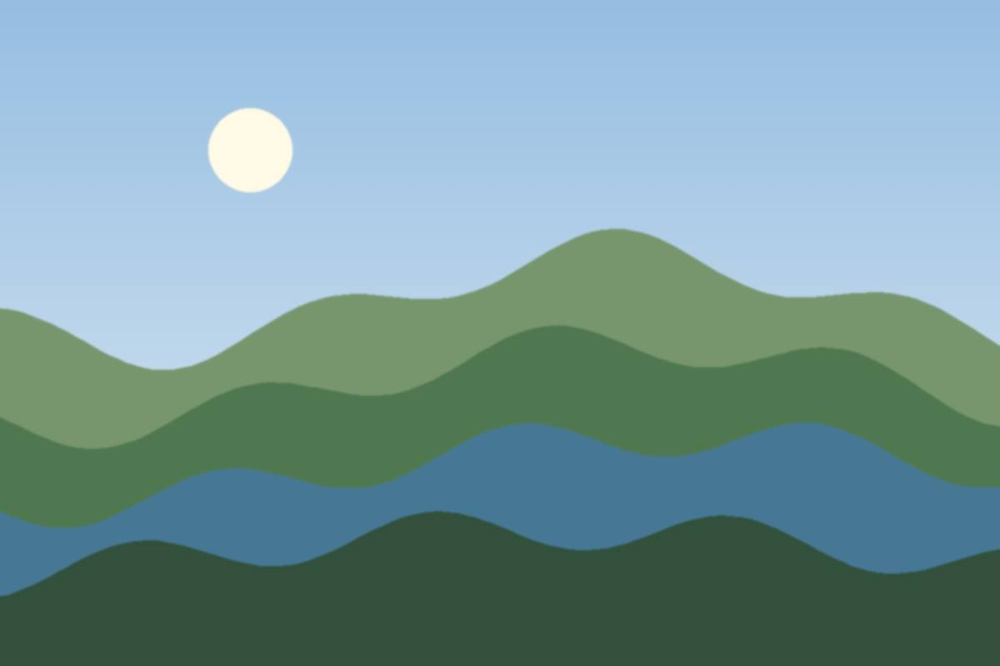
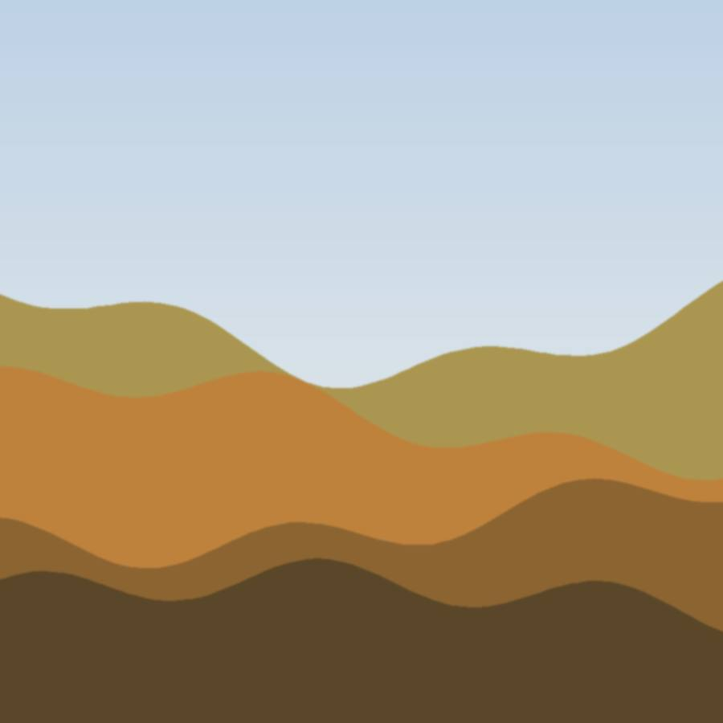

# Freitag, 9. Oktober · Cochem

Anreise mit dem Zug, am Nachmittag hinauf zur Burg. Abends Flammkuchen am Ufer.

# Samstag, 10. Oktober · Beilstein

Mit dem Rad flussaufwärts, 24 km, Mittagspause zwischen den Weinbergen.

::: {layout-ncol=2}

:::

| Tag | Strecke | Unterkunft |
|---|---|---|
| Fr | Anreise | Cochem |
| Sa | 24 km Rad | Beilstein |
| So | 11 km zu Fuß | Beilstein |
| Mo | Rückreise | – |

# Sonntag und Montag

Rundweg über die Höhen, am Montag zurück. Nächstes Mal: Traben-Trarbach mit mehr Zeit.
